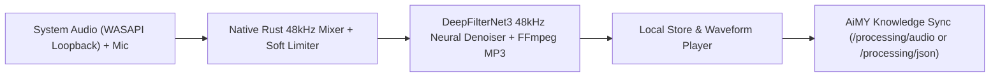

# AiMY Meetings Desktop Client

**AiMY Meetings Desktop Client** automatically detects your meetings, records both your microphone and meeting audio clearly, removes background noise with built-in AI (**DeepFilterNet3**), and syncs your recordings and notes straight to **AiMY Knowledge**.

Built as a fast, lightweight native desktop app powered by **Tauri v2 (Rust + WebView2)**, **React 19**, **TypeScript 5.8**, and the official **AiMY UI** design system (`@flairstech-aimy/ui`).

---

## Download & Install (Windows — No Technical Experience Needed)

Follow these 4 simple steps to get started in under 2 minutes:

1. **Download the Installer**:
   - Open the [**Latest Release Page**](https://github.com/Flairstech-AIMY/aimy-meetings-desktop-client/releases/latest).
   - Under **Assets**, click **`AiMY-Meetings-Desktop-Client-vX.Y.Z-win-x64-setup.exe`** to download it.
2. **Run the Installer**:
   - Double-click the downloaded `.exe` file and follow the quick setup prompts (no administrator password required).
   - *If Windows shows a blue "Windows protected your PC" popup*: click **More info**, then click **Run anyway**.
3. **Install FFmpeg (One-Time Audio Tool)**:
   - Press the **Windows** key, type **`Terminal`** (or **`PowerShell`**), and press **Enter**.
   - Copy and paste this line, press **Enter**, and type **`Y`** if asked to confirm:
     ```powershell
     winget install Gyan.FFmpeg
     ```
   - Once it finishes, close the window.
4. **Open & Sign In**:
   - Launch **AiMY Meetings Desktop Client** from your **Start Menu** or **Desktop**.
   - Click **Sign in with AiMY** in the top bar and log in with your AiMY account.
   - Open **Settings** (gear icon) to verify your **Target group** — you're ready to record!

> 👉 **Need screenshots-free, step-by-step help or the no-install portable ZIP?** Read the full [**Installation & Setup Guide**](docs/INSTALLATION.md).

---

## Documentation & Guides

| Document | Who It's For | Description |
| :--- | :--- | :--- |
| [**Installation & Setup Guide**](docs/INSTALLATION.md) | Everyone & Developers | Step-by-step non-technical Windows installation, first-time walkthrough, plain-English FAQ, plus developer setup from source. |
| [**Architecture & Technical Docs**](docs/ARCHITECTURE.md) | Developers | Deep dive into the Tauri v2 / Rust backend, native WASAPI capture, DeepFilterNet3 pipeline, Win32 meeting detection, and AiMY sync lifecycle. |
| [**Releases & Packaging Guide**](docs/RELEASES.md) | Maintainers | Semantic versioning, local `pnpm release:pack` packaging, and automatic GitHub Releases on push to `main`. |
| [**Changelog**](CHANGELOG.md) | Everyone | Complete version history and what's new in each release. |

---

## Key Features

- **Automatic Meeting Detection**:
  - Monitors **Microsoft Teams**, **Zoom**, **Google Meet**, **Slack Huddles**, **Cisco Webex**, and **Discord** using lightweight native Windows detection (no background scripts).
  - Smart filtering ignores idle Microsoft Teams tabs (`Chat`, `Calendar`, `Store`, `Settings`), popped-out chats, and pre-join audio/camera setup screens.
  - Pops a non-intrusive bottom-right banner asking to start recording — or starts and stops automatically when calls begin and end.
- **Crystal-Clear Audio Capture & DeepFilterNet3 AI Noise Cancellation**:
  - Captures both your **microphone** and **meeting/system audio** natively via Windows WASAPI loopback — no screen-sharing permission popups.
  - Cleans speech with bundled **DeepFilterNet3** (48 kHz neural noise suppression) + loudness normalization before saving compact `128 kbps` `.mp3` files.
  - Customize **Noise filtering strength (0–100%)** and **Post-filter** in **Settings → Calls & Audio**, and audition before/after audio live with the built-in **Audio Tester** (using the bundled noisy sample or a 6-second mic clip).
- **Interactive Waveform Playback & Meeting Notes**:
  - Scrub smoothly across recordings with the interactive waveform player, jump ±10 seconds, take structured meeting notes alongside your recording, or import existing `.mp3`, `.wav`, `.m4a`, `.mp4`, `.mov`, `.webm`, and `.ogg` files.
- **Offline-First AiMY Knowledge Sync**:
  - Sign in seamlessly through your default web browser (OAuth2 PKCE) or the built-in sign-in window. Credentials are encrypted with Windows DPAPI and refreshed automatically.
  - Works offline: recordings taken without internet are safely queued locally and auto-sync as soon as you're back online.
  - Supports both **Audio Recording Upload** (`POST /processing/audio`) with live upload `%` and **Notes Document Upload** (`POST /processing/json`), plus one-click **Add to Knowledge** and direct links to the AiMY Knowledge Console.

---

## Architecture at a Glance



---

## Quick Start for Developers (From Source)

Prerequisites: **Node.js 22+**, **pnpm 10+**, **Rust 1.80+ (`rustup`)**, **Visual Studio C++ Build Tools** (Windows), and **FFmpeg** on `PATH`.

```bash
# 1. Install frontend dependencies (uses FlairsTech AiMY UI registry in .npmrc)
pnpm install

# 2. Launch Tauri desktop app in development mode with Vite HMR
pnpm dev

# 3. Run TypeScript checks and Rust unit tests
pnpm typecheck
(cd src-tauri && cargo test)

# 4. Build production Windows installer & portable ZIP (release/)
pnpm release:pack
```

👉 *See [Part 2 of the Installation & Setup Guide](docs/INSTALLATION.md#part-2-developer-installation-from-source) for full build prerequisites and instructions.*
