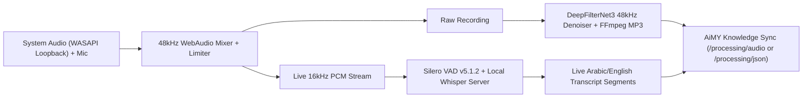

# AiMY Meetings

**AiMY Meetings** is a Notion-inspired desktop meeting recorder, neural speech enhancer, on-device bilingual (**Egyptian Arabic + English**) transcription studio, and **AiMY Knowledge** synchronization companion built with **Electron 35**, **React 19**, **TypeScript 5.8**, and the official **AiMY UI** design system (`@flairstech-aimy/ui` + `@flairstech-aimy/tokens`).

---

## Documentation & Guides

| Document | Description |
| :--- | :--- |
| [**Installation & Setup Guide**](docs/INSTALLATION.md) | End-user installation (Windows portable release + FFmpeg + Whisper models) and Developer local setup from source. |
| [**Architecture & Technical Docs**](docs/ARCHITECTURE.md) | Deep dive into dual-source audio capture, DeepFilterNet3 enhancement, Whisper + Silero VAD, meeting detection, and AiMY sync lifecycle. |
| [**Releases & Packaging Guide**](docs/RELEASES.md) | Versioning policy, `pnpm release:pack` packaging workflow, GitHub Releases publishing, and CI/CD automation. |
| [**Changelog**](CHANGELOG.md) | Version history and release notes (`v1.0.0`). |

---

## Key Features

- **Automatic Meeting Detection**:
  - Monitors **Microsoft Teams**, **Zoom**, **Google Meet**, **Slack Huddles**, **Cisco Webex**, and **Discord** (combining Windows `CapabilityAccessManager\ConsentStore` active microphone/webcam detection with Win32 window enumeration, plus macOS AppleScript support).
  - Smart filtering ignores idle Microsoft Teams tabs (`Chat`, `Calendar`, `Activity`) and pre-join audio/camera setup screens.
  - Pops a non-intrusive bottom-right banner asking to start recording (or starts and stops automatically when calls begin and end).
- **System + Microphone Audio Capture & DeepFilterNet3 Neural Denoising**:
  - Mixes Windows WASAPI loopback system audio and your microphone through a 48 kHz WebAudio broadcast limiter (`DynamicsCompressorNode`) to prevent clipping.
  - Enhances speech using **DeepFilterNet3** (`resources/bin/deep-filter.exe` — 48 kHz full-band neural noise suppression) + 80 Hz high-pass filtering + FFmpeg `dynaudnorm` loudness normalization before encoding to `128 kbps` `.mp3`.
- **On-Device Live & Full-File Transcription (Egyptian Arabic + English)**:
  - Powered by native `whisper.cpp` (`whisper-server.exe` & `whisper-cli.exe` with OpenBLAS/Vulkan) gated by **Silero VAD v5.1.2** (`ggml-silero-v5.1.2.bin`) so it only decodes active speech and consumes **0 MB RAM** when idle.
  - One-click model downloads in **Settings** for:
    - **`Whisper Large v3 Turbo — Egyptian AR + EN (Q5)`** (~547 MB) — Fine-tuned for Egyptian Arabic (`ar-EG`) + English code-switching (writes English technical terms in Latin script inside Arabic sentences).
    - **`Whisper Large v3 Turbo — Base (Q5)`** (~547 MB) — Standard OpenAI Whisper Large v3 Turbo quantized to 5-bit.
    - **`Whisper Small (Q5)`** (~181 MB) — Fast, lightweight fallback for low-memory laptops.
- **Direct AiMY Knowledge Authentication & Sync Dashboard**:
  - Click **Sign in with AiMY** to authenticate directly through the AiMY Cognito login window. Tokens are encrypted on disk via OS-level `safeStorage` and refreshed automatically.
  - Filter and track **All**, **Synced**, **In Progress** (recording, encoding, uploading with live `%`, transcribing on AiMY), and **Left to Sync** (offline/local pending, ready for review, or failed with one-click retry).
  - Supports both **Audio Recording Upload** (`POST /processing/audio`) and **Transcript + Notes Document Upload** (`POST /processing/json`), plus one-click **Add to Knowledge** (`POST /v2/documents/{id}/index`) and direct deep links to the AiMY Knowledge Console.

---

## Architecture at a Glance



---

## Quick Start

### For End Users (Pre-Built Windows Release)
1. Install **FFmpeg** once via Winget:
   ```powershell
   winget install Gyan.FFmpeg
   ```
2. Download **`AiMY-Meetings-v1.0.0-win-x64.zip`** from the [**Releases**](../../releases) page and extract it.
3. Launch **`AiMY Meetings.exe`**.
4. Click **Sign in with AiMY**, open **Settings** to pick your **Target group**, and download a **Whisper model** for live on-device transcription.

👉 *See the full [Installation & Setup Guide](docs/INSTALLATION.md) for detailed instructions and troubleshooting.*

### For Developers (From Source)

```bash
# 1. Install dependencies (uses FlairsTech AiMY UI registry configured in .npmrc)
pnpm install

# 2. Launch in development mode with Hot Module Replacement
pnpm dev

# 3. Run TypeScript checks
pnpm typecheck

# 4. Build production bundles (out/)
pnpm build

# 5. Package standalone Windows x64 portable release (release/AiMY-Meetings-v1.0.0-win-x64.zip)
pnpm release:pack
```

---

## Quick Testing Tips

1. Click **Sign in with AiMY** in the top bar and log in with your AiMY credentials.
2. Open **Settings** → confirm your default **Target group** and click **Test meeting banner** to preview the Notion-style meeting detection popup.
3. Click **Record meeting** (or **Import audio** with an existing `.mp3` / `.wav` / `.m4a`) to test the full capture → DeepFilterNet3 enhancement → on-device Whisper transcription → **Sync to AiMY** → **Add to Knowledge** → **Open in AiMY Knowledge** flow.
