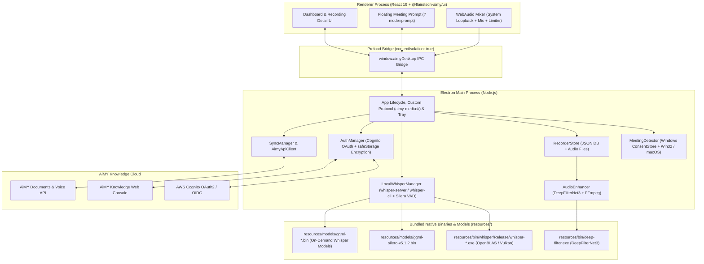
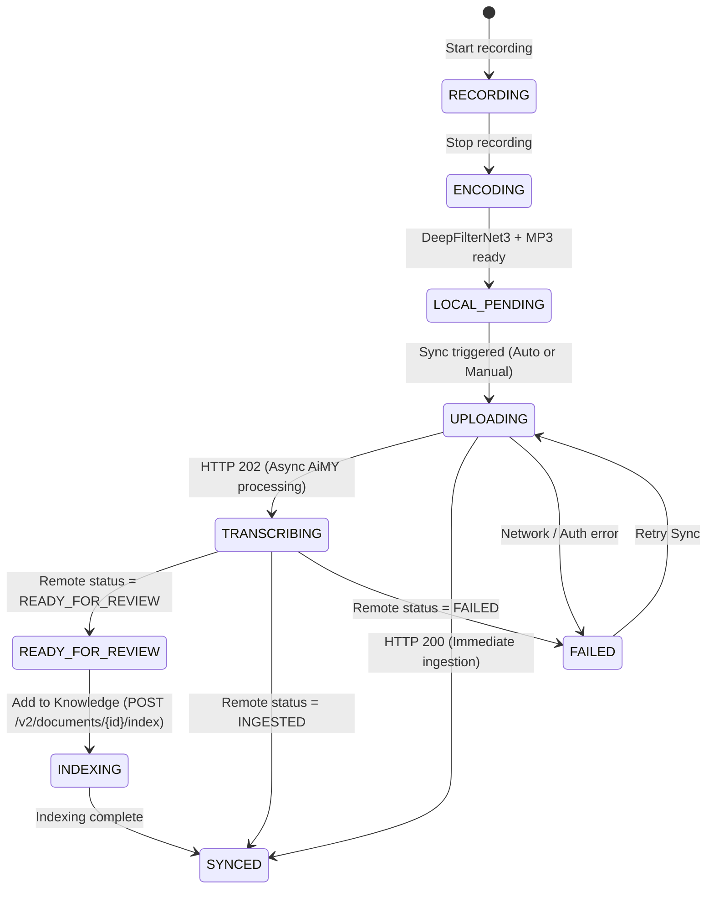

# AiMY Meetings — Architecture & Technical Documentation

**AiMY Meetings** is a desktop meeting recorder, on-device bilingual (Egyptian Arabic + English) transcription engine, neural audio enhancer, and **AiMY Knowledge** synchronization companion built with **Electron 35**, **React 19**, **TypeScript 5.8**, **Tailwind CSS 4**, and the official **AiMY UI** design system (`@flairstech-aimy/ui` + `@flairstech-aimy/tokens`).

---

## 1. System Architecture Overview



---

## 2. Project Directory Layout

```text
aimy-meetings/
├── .github/
│   └── workflows/
│       └── release.yml                 # Automated GitHub Release workflow on v* tags
├── docs/
│   ├── ARCHITECTURE.md                 # System architecture & internal technical reference
│   ├── INSTALLATION.md                 # End-user & developer installation guide
│   └── RELEASES.md                     # Packaging, versioning & release publishing guide
├── resources/
│   ├── icon.ico / icon.png / icon.svg  # Application branding icons
│   ├── tray-idle.png / tray-recording.png
│   ├── bin/
│   │   ├── deep-filter.exe             # DeepFilterNet3 48kHz full-band neural speech enhancer
│   │   └── whisper/Release/            # whisper.cpp OpenBLAS + Vulkan binaries & DLLs
│   └── models/
│       ├── ggml-silero-v5.1.2.bin      # Bundled Silero VAD v5.1.2 model (840 KB)
│       └── ggml-*.bin                  # On-demand Whisper Q5 models (downloaded in Settings)
├── scripts/
│   └── package-release.ps1             # Standalone Windows x64 release packager & SHA256 generator
├── src/
│   ├── main/
│   │   ├── index.ts                    # Electron entry point, tray, custom media protocol & IPC
│   │   ├── aimyApi.ts                  # Streaming multipart & JSON client for AiMY Knowledge API
│   │   ├── appIcons.ts                 # NativeImage icon loader for window, tray & notifications
│   │   ├── audioEnhancer.ts            # DeepFilterNet3 + FFmpeg loudness normalization pipeline
│   │   ├── auth.ts                     # Cognito login window, token extraction, safeStorage & refresh
│   │   ├── localWhisper.ts             # whisper-server / whisper-cli, Silero VAD & ar-EG hybrid builder
│   │   ├── meetingDetector.ts          # Active call detector (Teams, Zoom, Meet, Slack, Webex, Discord)
│   │   ├── promptWindow.ts             # Always-on-top bottom-right meeting detection banner window
│   │   ├── recorderStore.ts            # Persistent recordings/settings store & crash recovery
│   │   └── syncManager.ts              # Background upload, transcription polling & indexing manager
│   ├── preload/
│   │   └── index.ts                    # Type-safe contextBridge exposing window.aimyDesktop
│   ├── renderer/
│   │   ├── App.tsx                     # Main dashboard & meeting prompt router
│   │   ├── components/
│   │   │   ├── LiveRecorderBar.tsx     # Active recording controls, waveform & live transcript feed
│   │   │   ├── MeetingPrompt.tsx       # Notion-style bottom-right meeting detection banner
│   │   │   ├── RecordingCard.tsx       # Sidebar list item with live status badges & progress
│   │   │   ├── RecordingDetail.tsx     # Audio player, notes editor, local Whisper & AiMY sync actions
│   │   │   └── SettingsDialog.tsx      # Workspace targets, Whisper model manager & audio devices
│   │   └── lib/
│   │       ├── audioCapture.ts         # WebAudio loopback + microphone mixer & 16kHz PCM chunker
│   │       └── format.ts               # Timestamp, duration & file-size formatters
│   └── shared/
│       └── types.ts                    # Shared TypeScript interfaces, sync states & default settings
├── CHANGELOG.md
├── electron.vite.config.ts
├── package.json
└── README.md
```

---

## 3. Core Subsystems

### 3.1 Dual-Source Audio Capture & Broadcast Limiter (`src/renderer/lib/audioCapture.ts`)
1. **System Loopback Capture**: Uses Electron's `session.defaultSession.setDisplayMediaRequestHandler` to grant Windows WASAPI loopback audio (`audio: 'loopback'`) via `navigator.mediaDevices.getDisplayMedia` without prompting the user for a screen picker.
2. **Microphone Capture**: Requests the user's selected microphone with browser echo cancellation, noise suppression, and auto-gain control enabled.
3. **Mixing & Broadcast Limiting**: Both streams feed into a 48 kHz `AudioContext` through per-channel gain nodes (`0.95` system gain, `1.0` microphone gain) and a master `DynamicsCompressorNode` (`threshold: -6 dB`, `ratio: 12:1`, `attack: 3 ms`, `release: 150 ms`) to prevent clipping when multiple participants speak simultaneously.
4. **Parallel Outputs**:
   - **`MediaRecorder`**: Encodes the mixed stream at 128 kbps (`audio/webm;codecs=opus` or `audio/mp4`).
   - **Live 16 kHz PCM Chunker**: Downsamples mixed audio to 16 kHz 16-bit mono PCM slices every ~3.2 seconds (with energy gating) and streams them over IPC (`whisper:send-chunk`) to the local Whisper server.

### 3.2 Neural Speech Enhancement Pipeline (`src/main/audioEnhancer.ts`)
When a recording finishes (or when an audio file is imported or manually enhanced), `RecorderStore` runs a three-stage mastering pipeline:
1. **Pre-Conditioning (FFmpeg)**: Converts raw audio to 48 kHz 16-bit mono PCM WAV with an 80 Hz high-pass filter (`highpass=f=80`) and `-2 dB` headroom (`volume=-2dB`) to eliminate low-end rumble and prevent neural clipping.
2. **Full-Band Neural Denoising (`DeepFilterNet3`)**: Executes `resources/bin/deep-filter.exe --pf --compensate-delay` to remove background noise (fans, typing, street noise, room reverb) while preserving speech formants.
3. **Speech Loudness Normalization & MP3 Encoding (FFmpeg)**: Applies dynamic audio normalization (`dynaudnorm=f=150:g=15:p=0.9:m=10`) and encodes to a clean 44.1 kHz mono `128 kbps` `.mp3` ready for AiMY ingestion.
4. **Automatic Fallback**: If `deep-filter.exe` is unavailable, gracefully falls back to FFmpeg spectral FFT denoising (`highpass=f=80,afftdn=nf=-25,dynaudnorm=f=150:g=15:p=0.9:m=10`).

### 3.3 On-Device Whisper + Silero VAD Engine (`src/main/localWhisper.ts`)
- **Models Supported**:
  - `egyptian-turbo-q5_0` (**Whisper Large v3 Turbo — Egyptian AR + EN Q5**, ~547 MB): Hybrid fine-tuned model combining the standard `ggml-large-v3-turbo-q5_0.bin` encoder with the fine-tuned Egyptian Arabic + English code-switching decoder from `mohammedaly22/whisper-large-v3-turbo-egyptian-code-switching`, quantized on-device to `Q5_0` via `whisper-quantize.exe`.
  - `large-v3-turbo-q5_0` (**Whisper Large v3 Turbo — Base Q5**, ~547 MB): Standard multilingual OpenAI Whisper Large v3 Turbo quantized to 5-bit.
  - `small-q5_1` (**Whisper Small Q5**, ~181 MB): Lightweight fallback model for low-VRAM/CPU devices.
- **Silero VAD Gating**: Uses `resources/models/ggml-silero-v5.1.2.bin` (`--vad --vad-threshold 0.45`) so non-speech intervals are skipped before hitting the Whisper decoder.
- **Zero Idle Memory**: `whisper-server.exe` runs only during an active live-transcription recording and is terminated immediately when recording stops.
- **Hallucination & Script-Lock Sanitizer (`cleanAndValidateTranscript`)**:
  - Strips non-Arabic / non-Latin foreign script glitches (CJK, Cyrillic, Korean, Hebrew, etc.).
  - Collapses elongated characters (`/(.)\1{3,}/gu`), Whisper stuttering dots, and 3+ repeated phrases.
  - Blocks common silence hallucinations (`"Thank you"`, `"اشتركوا في القناة"`, bracketed music tags).

### 3.4 Automatic Meeting Detection (`src/main/meetingDetector.ts`)
- **Windows Detection Worker**: Spawns a hidden background PowerShell worker that polls every 2.5 seconds:
  1. Reads `HKCU:\Software\Microsoft\Windows\CurrentVersion\CapabilityAccessManager\ConsentStore\{microphone,webcam}` (both packaged and `NonPackaged` apps) where `LastUsedTimeStop == 0`.
  2. Enumerates visible top-level windows and their owning process names via P/Invoke `user32.dll` (`EnumWindows`, `IsWindowVisible`, `GetWindowText`, `GetWindowThreadProcessId`).
- **macOS Detection Worker**: Uses `osascript` (`System Events`) to inspect visible application windows every 4 seconds.
- **Supported Meeting Platforms**:
  - **Microsoft Teams** (Desktop & Web — automatically ignores idle chat/calendar tabs and pre-join setup screens)
  - **Zoom** (Desktop & Web)
  - **Google Meet** (Chrome, Edge, Brave, Firefox, Arc, Opera, Vivaldi)
  - **Slack Huddles** (Desktop & Web)
  - **Cisco Webex**
  - **Discord Voice Calls**
- **Auto-Start & Auto-Stop**:
  - Displays a non-intrusive bottom-right floating prompt (`PromptWindowManager`) or automatically starts recording if `autoRecordOnMeeting` is enabled.
  - Automatically stops recording when the meeting call ends (`autoStopOnMeetingEnd`) after 3 consecutive end-of-call polls (~7.5 seconds).

### 3.5 AiMY Knowledge Authentication & Sync State Machine (`src/main/auth.ts`, `src/main/syncManager.ts`)
- **Authentication**:
  - Opens an isolated `persist:aimy-auth` Electron `BrowserWindow` pointed at `${consoleBaseUrl}/console`.
  - Captures the Cognito `id_token`, `access_token`, and `refresh_token` via both `webRequest.onBeforeSendHeaders` and OIDC `localStorage`/`sessionStorage` inspection.
  - Encrypts credentials on disk at `%APPDATA%/aimy-meetings/auth-session.dat` using OS-level `safeStorage` (DPAPI on Windows, Keychain on macOS) and automatically refreshes tokens via Cognito `/oauth2/token` 60 seconds before expiry.
  - Also supports manual JWT token entry in Settings.
- **Sync Modes**:
  1. **`audio-recording` (Default)**: Streams the enhanced `.mp3` via multipart upload to `POST /processing/audio` (with automatic fallback to `POST /processing`) with real-time byte progress (`uploadProgress: 0..100`).
  2. **`transcript-json`**: Uploads structured Markdown containing meeting metadata, user notes, and the local Whisper transcript to `POST /processing/json`.
- **Recording Sync Lifecycle (`RecordingSyncStatus`)**:



---

## 4. Local Data & Custom Media Protocol

All user data is stored in Electron's `app.getPath('userData')` directory (`%APPDATA%\aimy-meetings` on Windows):

| File / Directory | Purpose |
| :--- | :--- |
| `settings.json` | Persisted `AppSettings` (target group, agents, audio devices, Whisper preferences) |
| `recordings.json` | Metadata, sync status, notes, and transcript segments for all recordings |
| `recordings/<id>.mp3` | Enhanced mono 128 kbps MP3 audio files |
| `auth-session.dat` | DPAPI / Keychain `safeStorage`-encrypted Cognito OAuth tokens |
| `models/` | Fallback user-writable directory for downloaded Whisper `.bin` models |

Audio playback in the renderer uses the custom privileged protocol `aimy-media://recording/<id>`, handled by `net.fetch(pathToFileURL(item.audioPath))` in the main process with full HTTP Range header support for instant scrubbing.
