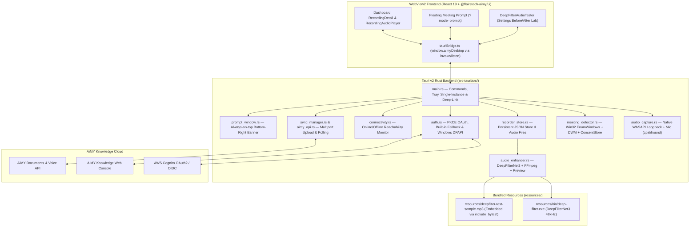
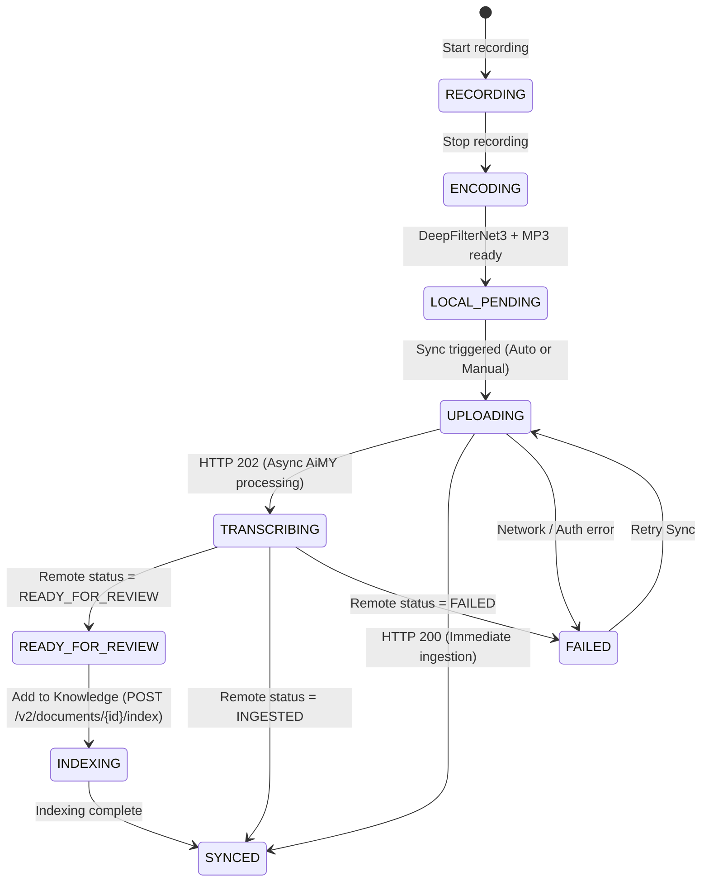

# AiMY Meetings Desktop Client — Architecture & Technical Documentation

**AiMY Meetings Desktop Client** is a native desktop meeting recorder, neural speech enhancer, and **AiMY Knowledge** synchronization companion built with **Tauri v2 (Rust + WebView2)**, **React 19**, **TypeScript 5.8**, **Tailwind CSS 4**, and the official **AiMY UI** design system (`@flairstech-aimy/ui` + `@flairstech-aimy/tokens`).

---

## 1. System Architecture Overview



---

## 2. Project Directory Layout

```text
aimy-meetings-desktop-client/
├── .github/
│   └── workflows/
│       └── release.yml                     # Auto-versioning & Windows x64 GitHub Release on push to main
├── docs/
│   ├── ARCHITECTURE.md                     # System architecture & internal technical reference
│   ├── INSTALLATION.md                     # End-user Windows setup & developer build guide
│   └── RELEASES.md                         # Packaging, versioning & CI/CD release guide
├── resources/
│   ├── icon.ico / icon.png / icon.svg      # Application branding icons
│   ├── mark.svg
│   ├── tray-idle.png / tray-recording.png  # Embedded system tray icons
│   ├── deepfilter-test-sample.mp3          # Embedded noisy speech clip for Settings Audio Tester
│   └── bin/
│       └── deep-filter.exe                 # DeepFilterNet3 48kHz full-band neural speech enhancer
├── scripts/
│   └── package-release.ps1                 # Windows x64 NSIS + portable ZIP packager & SHA256SUMS generator
├── src-tauri/
│   ├── Cargo.toml                          # Rust dependencies (tauri v2, cpal, hound, reqwest, windows-sys, ...)
│   ├── tauri.conf.json                     # Tauri v2 app metadata, NSIS bundler, asset protocol & deep-link
│   ├── capabilities/
│   │   └── default.json                    # Tauri v2 IPC capability permissions
│   ├── icons/                              # Bundled app icons for NSIS & exe metadata
│   └── src/
│       ├── main.rs                         # Tauri entry point, commands, tray, deep links & event wiring
│       ├── aimy_api.rs                     # Streaming multipart & JSON client for AiMY Knowledge API
│       ├── audio_capture.rs                # Native WASAPI loopback + mic mixer & soft-knee limiter (cpal)
│       ├── audio_enhancer.rs               # DeepFilterNet3 (0–100% strength + --pf) + FFmpeg + live preview
│       ├── auth.rs                         # System-browser PKCE OAuth, built-in fallback & DPAPI encryption
│       ├── connectivity.rs                 # Online/offline reachability monitor for local-first sync
│       ├── meeting_detector.rs             # Native Win32/DWM/ConsentStore detector + unit tests
│       ├── prompt_window.rs                # Always-on-top bottom-right meeting detection banner window
│       ├── recorder_store.rs               # Persistent recordings/settings store & crash recovery
│       ├── sync_manager.rs                 # Background upload, transcription polling & indexing manager
│       └── types.rs                        # Shared Rust/JSON data models
├── src/
│   ├── renderer/
│   │   ├── App.tsx                         # Main dashboard & meeting prompt router
│   │   ├── main.tsx                        # React 19 entry point + tauriBridge initialization
│   │   ├── styles.css                      # Tailwind CSS 4 + AiMY tokens + custom slider/player styles
│   │   ├── components/
│   │   │   ├── DeepFilterAudioTester.tsx   # Interactive before/after DeepFilterNet3 tester (built-in or 6s mic)
│   │   │   ├── LiveRecorderBar.tsx         # Active recording controls, waveform & live notes drawer
│   │   │   ├── MeetingPrompt.tsx           # Bottom-right meeting detection banner UI
│   │   │   ├── RecordingAudioPlayer.tsx    # 60fps waveform player with drag scrubbing & ±10s skip
│   │   │   ├── RecordingCard.tsx           # Sidebar list item with live status badges & upload %
│   │   │   ├── RecordingDetail.tsx         # Audio player, notes editor & AiMY sync actions
│   │   │   ├── SettingsDialog.tsx          # Workspace targets, DeepFilterNet3 tuning & audio settings
│   │   │   └── SignInPromptDialog.tsx      # Contextual sign-in modal (browser PKCE, built-in, local-only)
│   │   └── lib/
│   │       ├── audioCapture.ts             # Frontend controller bridging native cpal capture & fallback
│   │       ├── format.ts                   # Timestamp, duration & file-size formatters
│   │       └── tauriBridge.ts              # Typed window.aimyDesktop shim over Tauri invoke/listen
│   └── shared/
│       └── types.ts                        # Shared TypeScript interfaces, sync states & default settings
├── CHANGELOG.md
├── package.json
├── vite.config.ts
└── README.md
```

---

## 3. Core Subsystems

### 3.1 Native Dual-Source Audio Capture & Broadcast Limiter (`src-tauri/src/audio_capture.rs`)
1. **Native Windows WASAPI Loopback (`cpal`)**: Captures system/meeting audio directly from the default Windows output device in WASAPI loopback mode without requiring any screen-sharing dialog or browser permissions.
2. **Microphone Capture (`cpal`)**: Simultaneously opens the selected microphone input device (or system default) on a dedicated Rust capture thread.
3. **48 kHz Mixing & Soft-Knee Limiter**: Downmixes and resamples both inputs to 48 kHz mono, blends them in real time with a soft-knee hyperbolic-tangent (`tanh`) broadcast limiter to prevent clipping when multiple participants speak at once, and streams live audio levels back to the UI for the live waveform visualizer.
4. **Output**: Writes a clean temporary 48 kHz 16-bit PCM `.wav` file via `hound`, which is handed immediately to the enhancement/encoding pipeline when recording stops.

### 3.2 Neural Speech Enhancement Pipeline & Audio Tester (`src-tauri/src/audio_enhancer.rs`)
When a recording finishes (or when an audio file is imported or manually enhanced), `RecorderStore` runs a three-stage mastering pipeline:
1. **Pre-Conditioning (FFmpeg)**: Converts input audio to 48 kHz 16-bit mono PCM WAV with an 80 Hz high-pass filter (`highpass=f=80`) and `-2 dB` headroom (`volume=-2dB`) to eliminate low-end rumble and prevent neural clipping.
2. **Configurable Neural Denoising (`DeepFilterNet3`)**: Executes `bin/deep-filter.exe` with `--compensate-delay`, optional `--pf` post-filter, and `--atten-lim-db` mapped from the user's **0–100% Noise filtering strength** setting:
   - `0%` → bypass (no noise reduction)
   - `25%` (Light) → `10.0 dB`
   - `50%` (Balanced, default) → `20.0 dB`
   - `75%` (Strong) → `30.0 dB`
   - `100%` (Max) → `100.0 dB` (unlimited attenuation)
3. **Loudness Normalization & MP3 Encoding (FFmpeg)**: Applies dynamic speech normalization (`dynaudnorm=f=150:g=15:p=0.9:m=10`) and encodes to 44.1 kHz mono `128 kbps` `.mp3`.
4. **Automatic Fallback**: If `deep-filter.exe` is unavailable, falls back to FFmpeg spectral FFT denoising (`highpass=f=80,afftdn=nr=<dB>:nf=-25,dynaudnorm=...`).
5. **Interactive Before/After Audio Tester (`DeepFilterAudioTester.tsx` + `audio_preview_deepfilter`)**: Renders synchronized Original and Filtered MP3 previews right inside **Settings → Calls & Audio** using either the embedded noisy sample (`resources/deepfilter-test-sample.mp3`, compiled via `include_bytes!`) or a custom 6-second microphone recording.

### 3.3 Automatic Meeting Detection (`src-tauri/src/meeting_detector.rs`)
- **Pure Native Win32 Implementation (No PowerShell Subprocess)**: Polls every 2.5 seconds directly from Rust:
  1. Reads `HKCU\Software\Microsoft\Windows\CurrentVersion\CapabilityAccessManager\ConsentStore\{microphone,webcam}` (packaged and `NonPackaged` apps) where `LastUsedTimeStop == 0` via `winreg`.
  2. Enumerates visible top-level windows and owning process names via `windows-sys` (`EnumWindows`, `IsWindowVisible`, `GetWindowTextW`, `GetWindowThreadProcessId`), filtering out DWM-cloaked UWP/MSIX ghost windows (`DwmGetWindowAttribute`) and tiny helper overlays.
- **2-Poll Confirmation Debounce**: Requires 2 consecutive matching polls (~5 seconds) before firing so brief microphone blips or transient notifications never cause false alarms.
- **Supported Meeting Platforms**:
  - **Microsoft Teams** (Desktop & Web — strictly ignores idle tabs like `Chat`, `Calendar`, `Store`, `Settings`, popped-out chats, and pre-join device preview screens)
  - **Zoom** (Desktop & Web)
  - **Google Meet** (Chrome, Edge, Brave, Firefox, Arc, Opera, Vivaldi — strictly matched to the active browser process)
  - **Slack Huddles** (Desktop & Web)
  - **Cisco Webex**
  - **Discord Voice Calls**
- **Auto-Start & Auto-Stop**:
  - Displays a non-intrusive bottom-right floating prompt (`PromptWindowManager`) or starts recording automatically if `autoRecordOnMeeting` is enabled.
  - Automatically stops recording when the call ends (`autoStopOnMeetingEnd`) after consecutive end-of-call polls.

### 3.4 AiMY Knowledge Authentication, Offline-First & Sync State Machine
- **Authentication (`src-tauri/src/auth.rs`)**:
  - **System Browser PKCE OAuth (Default)**: Registers the `aimy-meetings://` custom URI scheme via `tauri-plugin-deep-link` and `tauri-plugin-single-instance`, opening AWS Cognito Hosted UI in the user's default browser using OAuth2 Authorization Code + PKCE (`S256`) so existing SSO sessions and password managers work seamlessly.
  - **Built-in Window Fallback**: Supports an in-app Tauri webview pointed at `${consoleBaseUrl}/console` if custom protocol redirects are blocked.
  - **DPAPI Token Storage & Legacy Migration**: Encrypts tokens on disk at `%APPDATA%\AiMY Meetings\auth-session.dat` via Windows DPAPI (`CryptProtectData` / `CryptUnprotectData`), and automatically decrypts legacy Electron `safeStorage` (`v10` AES-256-GCM) sessions so upgrading users stay signed in seamlessly.
  - **Proactive Refresh & Offline Suppression**: Refreshes tokens 60 seconds before expiry, retries once on `401`, and suppresses sign-in popups while offline so local recording is never disrupted.
- **Local-First & Reconnect Sync (`connectivity.rs`, `sync_manager.rs`, `aimy_api.rs`)**:
  - `ConnectivityMonitor` probes reachability periodically and when the frontend reports browser online/offline transitions.
  - Recordings captured offline or while signed out stay `LOCAL_PENDING` and auto-sync when connectivity and authentication return.
  - Supports **Audio Recording Upload** (`POST /processing/audio` with streaming byte progress `0..100%`) and **Notes Document Upload** (`POST /processing/json`).
- **Recording Sync Lifecycle (`RecordingSyncStatus`)**:



---

## 4. Local Data & Audio Playback

All user data is stored in `%APPDATA%\AiMY Meetings` on Windows (preserved identically from earlier releases so upgrades never lose local recordings or settings):

| File / Directory | Purpose |
| :--- | :--- |
| `settings.json` | Persisted `AppSettings` (target group, agents, DeepFilterNet3 strength/post-filter, audio & detection toggles) |
| `recordings.json` | Metadata, sync status, and meeting notes for all recordings |
| `recordings/<id>.mp3` | Enhanced mono 128 kbps MP3 audio files |
| `auth-session.dat` | Windows DPAPI-encrypted Cognito OAuth tokens |

Audio playback uses Tauri's scoped `asset://` protocol (restricted strictly to the user's `recordings/` directory via `asset_protocol_scope().allow_directory(...)`) paired with `RecordingAudioPlayer.tsx` for 60fps waveform scrubbing, click-and-drag seeking, and sync-safe playback state.
